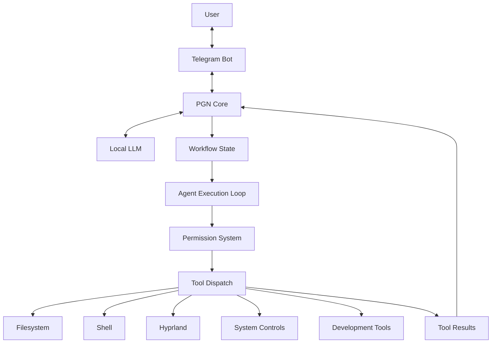

🐦 Pigeon General Network (PGN)
**Your Linux. Your AI. Your Pigeon.**

Pigeon General Network (PGN) is a personal AI environment for Linux. It connects a local language model to system tools, allowing an AI agent to interact with the operating system, manage files, control the desktop, and assist with software development.

PGN follows a **semi-autonomous execution model**: the user defines a goal, the agent works through the necessary steps, uses available tools, checks results, and requests permission before performing protected operations.

The project currently targets **Arch Linux with Hyprland** and uses a local LLM served through `llama-server`.

---

## ✨ Features

### AI Agent
- Local LLM integration through an OpenAI-compatible API.
- Function calling and multi-step task execution.
- Workflow-based execution with planning, execution, verification, and error correction phases.
- Conversation context management and automatic context compaction.
- Task cancellation.
- Limited self-update and restart mechanism.

### System Integration
- File and directory management.
- Shell command execution.
- Package management.
- Process management.
- Volume control.
- Clipboard interaction.
- Screenshot capture.
- Application launching.
- Yandex Music control.

### Hyprland Integration
- Retrieve information about open windows.
- List available workspaces.
- Switch between workspaces.
- Control windows.
- Execute Hyprland actions through `hyprctl`.

### Development Tools
PGN can interact with its own source code and project environment:

- Browse project directories.
- Read and edit project files.
- Inspect source code.
- Check Python syntax.
- View Git diffs.
- Run automated tests.
- Validate source changes before self-updating.

### Permission System
Tool execution is governed by five permission levels. Operations requiring additional authorization are presented to the user through Telegram, where they can be approved or rejected.

---

## 🏗️ Architecture



### Main Components

| Component | Responsibility |
|---|---|
| `pai_g.py` | Agent core, LLM communication, tool execution, permissions, and workflow management |
| `bot.py` | Telegram interface, user authorization, confirmations, and task control |
| `llama-server` | Local model inference through an OpenAI-compatible API |
| `PAIWorkspace` | Dedicated workspace for agent file operations |

### Execution Flow

1. The user sends a request through Telegram.
2. PGN initializes or resumes the conversation context.
3. The local LLM processes the request.
4. The agent selects and invokes available tools.
5. The permission system determines whether an operation requires confirmation.
6. The user approves or rejects protected operations through Telegram.
7. Tool results are returned to the agent.
8. PGN continues execution, verifies changes when necessary, or sends a final response.

---

## 🔐 Permission System

PGN uses five permission levels:

| Level | Meaning |
|---|---|
| `READ` | Read-only operations |
| `LOW` | Low-risk actions |
| `MEDIUM` | Operations that modify system state |
| `HIGH` | Potentially destructive or sensitive operations |
| `CRITICAL` | Critical operations with potentially irreversible effects |

When confirmation is required, PGN sends a Telegram message with approval and rejection buttons.

Critical shell commands are subject to additional restrictions. For example, commands involving `sudo` are not automatically allowed merely because the user confirms them.

The goal is to keep the user in control of system-level actions instead of giving the agent unrestricted access.

---

## 🛠️ Tech Stack

- **Python** — application logic.
- **OpenAI Python SDK** — communication with the local model API.
- **llama.cpp / llama-server** — local LLM inference.
- **aiogram** — Telegram bot interface.
- **httpx** — asynchronous HTTP communication.
- **Hyprland / hyprctl** — desktop environment integration.
- **pytest** — automated testing.

---

## 📋 Requirements

- Arch Linux.
- Python 3.
- A compatible GGUF model.
- `llama-server`.
- Telegram bot token.
- Hyprland for desktop integration.

The current core configuration expects the model server at:

```text
http://127.0.0.1:8080/v1
```

The health endpoint used by the Telegram bot is:

```text
http://127.0.0.1:8080/health
```

The configured model identifier in the agent is:

```text
Ornith-1.5-9B-Q4_K_M.gguf
```

---

## 🚀 Installation

### 1. Clone the repository

```bash
git clone https://github.com/kuplugarazh/PGN.git
cd PGN
```

The current systemd examples expect the project to be located at `~/pai`. If you use another directory, adjust the service files accordingly.

### 2. Create a virtual environment

```bash
python -m venv .venv
source .venv/bin/activate
```

### 3. Install dependencies

```bash
python -m pip install -r requirements.txt
```

For development:

```bash
python -m pip install -r requirements-dev.txt
```

### 4. Configure environment variables

```bash
cp .env.example .env
```

Edit `.env` and provide your Telegram bot token and authorized Telegram user ID.

### 5. Configure llama-server

Install `llama-server` and make sure the executable is available at:

```text
/usr/bin/llama-server
```

Copy the example service:

```bash
mkdir -p ~/.config/systemd/user
cp systemd/llama-server.service.example ~/.config/systemd/user/llama-server.service
```

Edit the service file and replace:

```text
/path/to/your/model.gguf
```

with the actual path to your GGUF model.

The example uses the following inference settings:

| Parameter | Default |
|---|---:|
| Context size | 53248 |
| GPU layers | 40 |
| Parallel slots | 1 |
| CPU threads | 6 |
| Batch size | 512 |
| Micro-batch size | 512 |
| K-cache quantization | `q8_0` |
| V-cache quantization | `q8_0` |

These are example settings, not universal recommendations. Adjust GPU layers and other parameters to match your hardware and model.

### 6. Configure the Telegram bot service

```bash
cp systemd/pai-bot.service.example ~/.config/systemd/user/pai-bot.service
```

The example expects the project at `~/pai` and the virtual environment at `~/pai/.venv`.

### 7. Reload systemd

```bash
systemctl --user daemon-reload
```

---

## ▶️ Running

Start the Telegram bot:

```bash
systemctl --user start pai-bot.service
```

To start it automatically with your user session:

```bash
systemctl --user enable pai-bot.service
```

The bot checks whether `llama-server` is running and starts `llama-server.service` when necessary.

The model server is stopped after 10 minutes of inactivity to free GPU memory.

### Useful systemd commands

```bash
systemctl --user status pai-bot.service
systemctl --user status llama-server.service
```

View logs:

```bash
journalctl --user -u pai-bot.service -f
journalctl --user -u llama-server.service -f
```

### Telegram Commands

| Command | Description |
|---|---|
| `/new` | Clear the current conversation context |
| `/stop` | Stop the local model server and reset the conversation |
| `/cancel` | Request cancellation of the current task |

The bot also provides inline buttons for approving protected actions and interrupting active tasks.

---

## 🧠 Context Management

PGN maintains conversation context during interaction and automatically resets it after three user requests in the Telegram interface.

When the context reaches a configured size threshold, the agent attempts to summarize older messages while preserving recent tool interactions.

The project also has a restart-state mechanism used during self-updates. This should not be confused with persistent long-term memory: a general-purpose persistent memory system is not currently implemented.

---

## 🧪 Development

Install development dependencies:

```bash
python -m pip install -r requirements-dev.txt
```

Run tests:

```bash
python -m pytest -v
```

The current test suite covers selected core and permission-system behavior.

PGN also includes tools that allow the agent to inspect and modify project files, check syntax, inspect Git changes, and execute tests.

---

## 🗺️ Roadmap

- [x] Local LLM integration
- [x] Telegram interface
- [x] Filesystem tools
- [x] Permission levels and user confirmations
- [x] Hyprland integration
- [x] System management tools
- [x] Development and self-editing tools
- [x] Workflow-based task execution
- [x] Context compaction
- [ ] More advanced task planning and decomposition
- [ ] Persistent long-term memory
- [ ] Expand tool integrations
- [ ] Improve workflow recovery and reliability
- [ ] Desktop-native interface
- [ ] Home Assistant integration
- [ ] More comprehensive documentation

---

## 💡 Philosophy

PGN is not intended to be an unrestricted autonomous agent.

It is a personal environment where AI can interact with the operating system, perform useful tasks, and assist with development — while the user retains control over important decisions and potentially dangerous operations.

**The goal is simple: make Linux more capable through a personal AI layer, without giving up control of your own system.**

---

<p align="center">
  <b>🐦 Pigeon General Network</b><br>
  Your Linux. Your AI. Your Pigeon.
</p>
