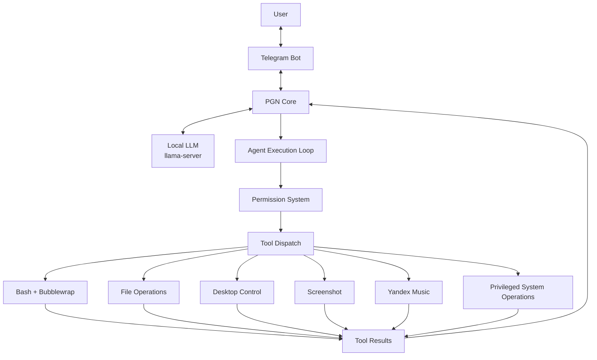

# 🐦 Pigeon General Network (PGN)

**Your Linux. Your AI. Your Pigeon.**

Pigeon General Network (PGN) is a personal AI environment for Linux. It combines a conversational assistant with an AI agent capable of interacting with the operating system, managing files, controlling the desktop, and executing multi-step tasks.

PGN follows a **semi-autonomous execution model**: the user defines a goal, the agent independently plans and performs the necessary steps, checks the results, and requests confirmation before sensitive operations.

The project currently targets **Arch Linux with Hyprland** and uses a local language model served through `llama-server`.

---

## ✨ Features

### AI Agent

- Local LLM integration through an OpenAI-compatible API.
- Function calling and multi-step task execution.
- Autonomous planning, execution, and result verification.
- Automatic context compaction.
- Task cancellation.
- Limited self-update and restart support.

### Linux Integration

PGN uses a universal Bash terminal as its primary interface for interacting with the operating system.

The agent can:

- Navigate and search the filesystem.
- Execute shell commands and scripts.
- Work with Git repositories.
- Install and manage software through authorized system operations.
- Inspect and manage processes.
- Control audio through PipeWire utilities.
- Interact with the clipboard.
- Retrieve system information.

### Desktop Control

Hyprland integration allows PGN to:

- Launch applications.
- Execute graphical commands.
- List open windows and workspaces.
- Switch between workspaces.
- Focus, close, move, minimize, and fullscreen windows.

### File Management

- Read text files.
- Create and overwrite files.
- Perform precise text replacements.
- Automatically create backups before modifications.
- Validate Python syntax after editing Python files.
- Protect sensitive files and directories.

### Additional Integrations

- Screenshot capture and delivery through Telegram.
- Yandex Music playback control.
- Privileged system operations with user confirmation.

---

## 🏗️ Architecture

PGN consists of two main Python components connected to a local language model.



### Main Components

| Component            | Responsibility                                                          |
| -------------------- | ----------------------------------------------------------------------- |
| `pai_g.py`           | Agent core, LLM communication, execution loop, tools, and permissions   |
| `bot.py`             | Telegram interface, user authorization, confirmations, and task control |
| `llama-server`       | Local model inference through an OpenAI-compatible API                  |
| Bubblewrap (`bwrap`) | Isolation of Bash command execution                                     |

### Execution Flow

1. The user sends a request through Telegram.
2. PGN adds the request to the conversation context.
3. The local LLM analyzes the task and decides what to do.
4. The agent invokes the required tools.
5. The permission system checks whether an operation requires confirmation.
6. The user approves or rejects protected operations through Telegram.
7. Tool results are returned to the LLM.
8. The agent continues working until the task is completed, cancelled, or the execution limit is reached.

The agent can perform up to **30 execution steps per request**.

---

## 🧰 Tool System

PGN currently has eight core tools.

| Tool                   | Purpose                                                |
| ---------------------- | ------------------------------------------------------ |
| `bash`                 | General-purpose Linux terminal                         |
| `read_file`            | Read text files                                        |
| `write_file`           | Create or overwrite files                              |
| `edit_file`            | Replace a specific text fragment in a file             |
| `desktop_control`      | Control Hyprland windows, workspaces, and applications |
| `take_screenshot`      | Capture the screen and send it through Telegram        |
| `yandex_music_control` | Control Yandex Music                                   |
| `privileged_system`    | Perform authorized package and systemd operations      |

The terminal is the primary general-purpose tool. Specialized tools are used when they provide a more reliable interface for a particular operation.

---

## 🔐 Security

PGN aims to provide broad system access while keeping sensitive operations under user control.

### Permission Levels

The permission system defines five levels:

| Level      | Meaning                                         |
| ---------- | ----------------------------------------------- |
| `READ`     | Read-only operations                            |
| `LOW`      | Low-risk operations                             |
| `MEDIUM`   | Operations requiring additional authorization   |
| `HIGH`     | Sensitive or potentially destructive operations |
| `CRITICAL` | Critical operations                             |

The actual permission assigned depends on the tool and target.

Examples:

- Reading files and taking screenshots do not require confirmation.
- Bash, desktop control, and music control normally execute automatically.
- Changes to ordinary files are performed automatically with backups.
- Changes to PGN source code and the main Hyprland configuration require confirmation.
- Privileged system operations require confirmation.

When confirmation is needed, PGN sends an approval request to Telegram.

### Bubblewrap Sandbox

Bash commands are executed through Bubblewrap (`bwrap`) when it is available.

The sandbox configuration includes:

- A read-only root filesystem.
- A writable home directory.
- A temporary `/tmp` directory.
- Access to the runtime directory required for desktop integration.
- Masking of selected sensitive directories, including `.ssh`, `.gnupg`, `.aws`, and keyrings.
- Protection of `.env` files.
- A custom `rm` wrapper that moves deleted files into a quarantine directory.

**Important:** The home directory remains writable inside the sandbox. This is not a fully isolated container. Also, the current implementation falls back to ordinary Bash if Bubblewrap is unavailable. Install Bubblewrap to get the intended sandbox behavior.

### Backups and File Deletion

Before modifying an existing file, PGN creates a backup in:

```text
~/.local/share/pgn/backups/
```

Files deleted through the sandbox's `rm` wrapper are moved to:

```text
~/.local/share/pgn/trash/
```

These mechanisms provide an additional recovery layer but do not replace regular backups of important data.

---

## 🛠️ Tech Stack

- **Python** — application logic.
- **OpenAI Python SDK** — communication with the local model API.
- **llama.cpp / llama-server** — local LLM inference.
- **aiogram** — Telegram bot interface.
- **httpx** — asynchronous HTTP communication.
- **python-dotenv** — environment variable loading.
- **websocket-client** — Yandex Music integration.
- **Bubblewrap** — command sandboxing.
- **Hyprland / hyprctl** — desktop integration.

---

## 📋 Requirements

- Arch Linux.
- Python 3.
- Hyprland for desktop integration.
- A compatible GGUF language model.
- `llama-server`.
- Bubblewrap (`bwrap`).
- `yay` for privileged package operations.
- `grim` for screenshots.
- A Telegram bot token and authorized Telegram user ID.

Install the required system utilities:

```bash
sudo pacman -S bubblewrap grim
```

The core connects to the local model server at:

```text
http://127.0.0.1:8080/v1
```

The Telegram bot checks the health endpoint:

```text
http://127.0.0.1:8080/health
```

The current model identifier configured in the core is:

```text
Ornith-1.5-9B-Q4_K_M.gguf
```

---

## 🚀 Installation

### 1. Clone the repository

```bash
git clone https://github.com/kuplugarazh/PGN.git
cd PGN
```

The current systemd examples expect the project to be located at `~/pai`. If you use another directory, adjust the service files and paths accordingly.

### 2. Create a virtual environment

```bash
python -m venv .venv
source .venv/bin/activate
```

### 3. Install Python dependencies

```bash
python -m pip install -r requirements.txt
```

For development:

```bash
python -m pip install -r requirements-dev.txt
```

### 4. Configure environment variables

Create the environment file:

```bash
cp .env.example .env
```

Set the following variables:

```env
TELEGRAM_BOT_TOKEN=your_bot_token
TELEGRAM_ALLOWED_USER_ID=your_telegram_user_id
```

The bot also supports the alternative names `BOT_TOKEN` and `ALLOWED_USER_ID`.

### 5. Configure llama-server

Install `llama-server` and make sure it is available at:

```text
/usr/bin/llama-server
```

Copy the example service:

```bash
mkdir -p ~/.config/systemd/user
cp systemd/llama-server.service.example ~/.config/systemd/user/llama-server.service
```

Edit the service file and replace the example model path with the actual path to your GGUF model.

### 6. Configure the Telegram bot service

```bash
cp systemd/pai-bot.service.example ~/.config/systemd/user/pai-bot.service
```

The example expects the project at `~/pai` and the virtual environment at `~/pai/.venv`.

### 7. Reload systemd

```bash
systemctl --user daemon-reload
```

---

## ▶️ Running

Start the Telegram bot:

```bash
systemctl --user start pai-bot.service
```

Enable automatic startup with your user session:

```bash
systemctl --user enable pai-bot.service
```

The bot checks whether `llama-server` is running and starts `llama-server.service` when necessary.

After **10 minutes of inactivity**, the bot stops the model server to release GPU memory.

### Useful systemd Commands

Check service status:

```bash
systemctl --user status pai-bot.service
systemctl --user status llama-server.service
```

View logs:

```bash
journalctl --user -u pai-bot.service -f
journalctl --user -u llama-server.service -f
```

### Telegram Commands

| Command   | Description                                            |
| --------- | ------------------------------------------------------ |
| `/new`    | Clear the current conversation context                 |
| `/stop`   | Stop the local model server and reset the conversation |
| `/cancel` | Request cancellation of the current task               |

The bot also provides inline buttons for approving protected operations and interrupting active tasks.

---

## 🧠 Context Management

PGN maintains conversation context during interaction.

- The agent automatically compacts older conversation history when it reaches a configured size threshold.
- Recent messages and tool interactions are preserved during compaction.
- The Telegram interface automatically resets the conversation after 10 user requests.
- The `/new` command allows manual context reset.

The project also includes a restart-state mechanism for recovering conversation state during supported self-update operations.

A persistent long-term memory system is not currently implemented.

---

## 🗺️ Roadmap

- [x] Local LLM integration
- [x] Telegram interface
- [x] Multi-step agent execution
- [x] Universal Bash terminal
- [x] Bubblewrap-based command isolation
- [x] Filesystem tools
- [x] Automatic file backups
- [x] Safe file deletion through quarantine
- [x] Permission checks and Telegram confirmations
- [x] Hyprland desktop integration
- [x] Screenshot capture
- [x] Yandex Music integration
- [x] Context compaction
- [ ] Persistent long-term memory
- [ ] More advanced planning and task decomposition
- [ ] Improve execution recovery and reliability
- [ ] Desktop-native interface
- [ ] Home Assistant integration

---

## 💡 Philosophy

PGN is not intended to be an unrestricted autonomous agent.

It is a personal AI environment that combines conversation with practical control over the Linux operating system.

The user defines the goal. PGN plans, executes, checks its work, and asks for authorization when an operation requires additional control.

**The goal is simple: make Linux more capable through a personal AI layer, without giving up control of your own system.**

---

\<p align="center">   \<b>🐦 Pigeon General Network\</b>\<br>   Your Linux. Your AI. Your Pigeon. \</p>
